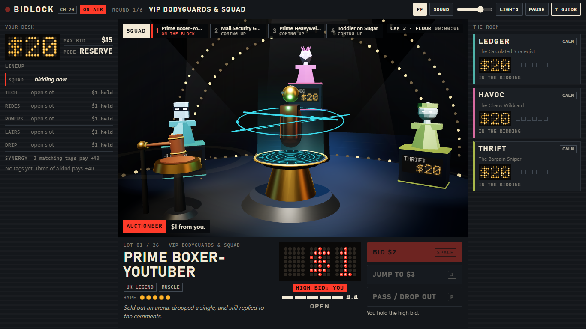
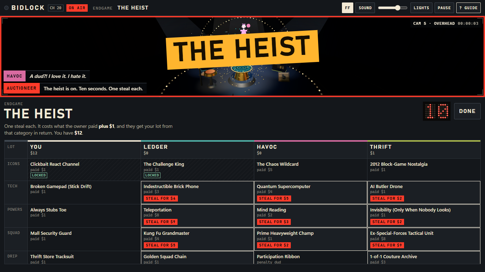
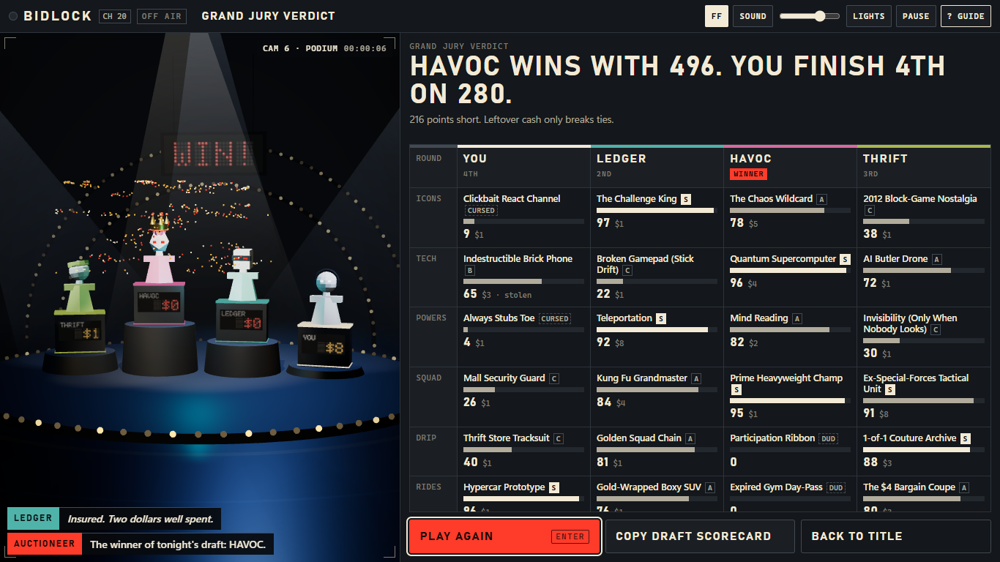
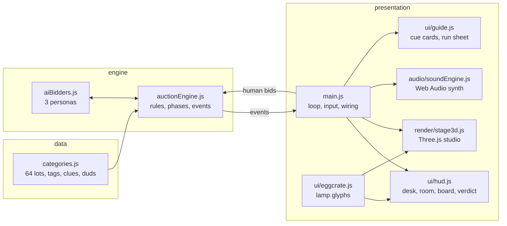

# BidLock: The $20 Draft

**One $20 budget. Six heated categories. Outbid, bait, and heist your way to the ultimate lineup.**

BidLock is a browser auction game for one player against three house rivals. Everyone gets the same $20 and has to draft a six-lot lineup, one dollar at a time, with a five-second shot clock on every bid. Two sealed mystery crates turn up mid-show, and before the scores are opened there is a vault and a ten-second heist.

It is a static site: plain HTML, CSS and ES modules. There is no build step and nothing to install to play. Every model, texture, lamp, sound and note of music is generated in code. The only thing fetched from the network is Three.js, from a CDN.



| Title | Heist | Verdict |
| --- | --- | --- |
|  |  |  |

## Play

```bash
node tools/serve.mjs
```

Then open `http://localhost:5173`. Any static file server works (`python -m http.server`, VS Code Live Server). Opening `index.html` straight from disk does not, because browsers block ES modules on `file://`.

## Rules

**Setup.** Four contenders: you, LEDGER, HAVOC and THRIFT. Each starts with $20, or $50 in High-Roller mode. A match drafts six of the seven lifestyle categories, picked at random.

**A round.** Each round sells four lots from one category. Every contender must end the round with exactly one. The weakest of the four always comes last, so a round is musical chairs: three real lots, four contenders, and whoever never commits is left with the booby prize for $1.

**Bidding.** Lots open at $1. You can bid one dollar more, power-jump two, or drop out of the lot for good. Every bid resets the shot clock to 5.0 seconds: going once at 3, going twice at 2, last call at 1, then the hammer.

**Budget lockout.** Your max bid is your cash minus $1 for every other slot you still have to fill, so you can never lock yourself out of a round. Tick **All-In Gamble** on the title screen to play without that reserve; any slot you cannot fill gets a $0 Penalty Dud (Rusty Shopping Trolley, 144p Webcam and friends).

**Mystery crates.** Two sealed crates are dropped between rounds. You see a crate and one clue. The winner's crate bursts open to show a jackpot or a cursed item. Crates sit outside the six slots and add to your total.

**Vault.** After the last lot you have ten seconds to pay $2 to lock a lot. Locked lots cannot be stolen.

**Heist.** Then ten seconds in which each contender may make one steal from any unlocked lineup. A steal costs what the owner paid plus $1, and it is a forced swap: the victim is left holding the thief's lot from that category. Bargains are the easiest things to steal, so they are the ones worth locking.

**Verdict.** The sealed value of every lot (1 to 100) is revealed round by round. Three lots sharing a synergy tag pay +40; five pay +80. Highest total wins. Leftover cash only breaks ties.

### What you can and cannot see

| Public | Sealed until the verdict |
| --- | --- |
| Lot name, tags, hype (1 to 5 lamps) | True value and tier |
| The four lots of the round, in order | What is in a crate |
| Every rival's cash, lineup and mood | |

Hype is the room's opinion and is sometimes wrong. The studio even dresses the 3D sculpture by hype, so an overhyped lot looks golden.

### The rivals

| Rival | Style | Tell |
| --- | --- | --- |
| **LEDGER**, the Calculated Strategist | Works out a dollar limit from value per point and never goes past it | Bids late; snipes headline lots with 0.6 s on the clock |
| **HAVOC**, the Chaos Wildcard | Plays All-In with a noisy read on value | Power-jumps crates and junk to bait you, then drops out |
| **THRIFT**, the Bargain Sniper | Hoards through rounds 1 to 3, then outspends a broke room in 4 to 6 | Rarely goes above $2 early |

Each has a reaction delay of 350 to 1400 ms, four moods (calm, sweating, smug, raging) that change their timing and lines, and its own vault and heist logic.

## Controls

| Key | Action |
| --- | --- |
| `Space` or `B` | Bid one dollar more |
| `J` | Power jump: two dollars more |
| `P` | Pass and drop out of this lot |
| `Enter` | Go live, skip an intro, finish the vault or heist |
| `F` | Fast-forward lots you are not bidding on |
| `M` | Mute |
| `Esc` | Pause |
| `?` | Open the run sheet (guide, keys, glossary) |
| `←` `→` | Step through the guide |

Everything also works by mouse or touch. The top bar has sound, a volume slider, a lights toggle (dark studio or house lights up) and pause.

## Architecture



The engine is pure: no DOM, no audio, no rendering, and deterministic for a given seed. `main.js` runs it on a fixed 1/60 s timestep and turns its events (`bid`, `call`, `sold`, `mysteryReveal`, `heist`, `verdict` and so on) into HUD updates, stage animation and sound. That is also why the rules can be tested headless in Node.

| File | What it does |
| --- | --- |
| `index.html` | Semantic layout, HUD regions, run sheet, cue cards, ES module entry |
| `css/styles.css` | Design tokens, dark and light themes, layouts from 375 px up |
| `js/main.js` | Screen state machine, fixed-timestep loop, input, engine wiring |
| `js/data/categories.js` | 8 categories x 8 lots, synergy tags, crate clues, penalty duds |
| `js/engine/auctionEngine.js` | Budget rules, shot clock, crates, vault, heist, scoring |
| `js/engine/aiBidders.js` | LEDGER, HAVOC, THRIFT: valuation, timing, bluffing, banter |
| `js/render/stage3d.js` | Studio set, pedestal, gavel, podiums, particles, cameras |
| `js/audio/soundEngine.js` | Gavel, ticks, heartbeat, register, riser, stings, backing track |
| `js/ui/eggcrate.js` | 5x7 lamp glyphs shared by the HUD and the 3D podium screens |
| `js/ui/hud.js` | All DOM painting, chyrons, board, verdict table, scorecard text |
| `js/ui/guide.js` | First-run guide and help drawer |
| `tools/serve.mjs` | Tiny static server for local play and tests |

Match phases: `CATEGORY_INTRO → LOT_INTRO → BIDDING → SOLD → (REVEAL)` for each of 26 lots, then `VAULT → HEIST → VERDICT`.

## Design: "Channel 20"

The interface is a live television broadcast rather than a generic game HUD. Each reference became a specific part of the UI.

| Reference | Became |
| --- | --- |
| Eggcrate lamp displays, the bulb-matrix scoreboards of 1970s and 80s studio game shows | Every price, cash total and clock, drawn lamp by lamp from a 5x7 glyph table (no font file); also the hanging price sign and podium screens in 3D |
| Character-generator lower thirds ("chyrons") | Auctioneer calls and rival banter slide in as tabbed lower thirds |
| Broadcast colour bars and test cards | Loading, pause, no-WebGL and fault states are all a "please stand by" card |
| Camera tally lights and ON AIR lamps | The one red in the palette. It only ever means live: on air, your high bid, the button that puts you there |
| Marquee chase lights | Bulbs around the stage rim and arches, chasing faster as the hammer comes down |
| A floor manager's cue cards | The first-run guide: ruled cards with punched holes, "CUE 3 / 11" |
| A production run sheet | The help drawer: pipeline, key map, glossary |

The guide is offered once and never forced, because Nielsen Norman Group's study of onboarding tutorials found that users who skipped them did no worse, and rated the apps easier to use.

Sources:
- [Eggcrate and other numeric displays](https://blair-neal.gitbook.io/survey-of-alternative-displays/legacy/eggcrate-and-other-numeric-displays), Survey of Alternative Displays
- [Lower third](https://en.wikipedia.org/wiki/Lower_third) and [Character generator](https://wikipedia.com/wiki/Character_generator), Wikipedia
- [Philips circle pattern](https://en.wikipedia.org/wiki/Philips_circle_pattern), Wikipedia
- [Study of mobile tutorials](https://www.nngroup.com/articles/mobile-tutorials/) and [Examples of Tutorials in Apps](https://www.nngroup.com/articles/onboarding-tutorials/), Nielsen Norman Group

Type uses system stacks only (Bahnschrift or DIN condensed for display, the system UI face for text, the system mono for labels), so no fonts are downloaded. Motion is switched off under `prefers-reduced-motion`.

## Tests

```bash
npm install
```

```bash
npm test
```

- `tests/engine.test.mjs` runs in plain Node: database checks, then 180 simulated matches asserting that money is conserved, every slot is filled, no lot is owned twice, the lockout holds and scores add up.
- `tests/e2e.mjs` drives Edge or Chrome through the title hero, the guide (invite, tour across screens, Esc, never shown again), the run sheet, keyboard and mouse bidding, crate, vault, heist, verdict, scorecard copy, a whole unattended match, and a 390 px phone. It also writes the images in `screenshots/`.

`playwright-core` is the only dependency and is only needed for the browser tests.

Handy URL switches: `?seed=42` fixes the match, `?speed=4` runs the clock faster, `?auto=1` lets a simple autopilot play your seat, `?guide=off` hides the first-visit invitation.

## Deploy

The repository is the site. Nothing needs building.

**GitHub Pages**
1. Push to GitHub.
2. In the repository, open Settings → Pages.
3. Under "Build and deployment", choose "Deploy from a branch", branch `main`, folder `/ (root)`, and save.
4. The game appears at `https://<user>.github.io/BidLock/` after a minute or so.

The empty `.nojekyll` file tells Pages to serve the files as they are.

**Netlify or Vercel**: import the repository, leave the build command empty and set the publish directory to the repository root.

## Notes

- **3D needs WebGL and a route to the CDN.** If either is missing, the feed shows a NO SIGNAL card and the auction still plays from the desk.
- **Slow graphics.** If frames run slow the stage lowers its resolution and turns shadows off by itself.
- **Sound starts on your first click or key press**, because browsers do not allow audio before that.

## Credits

The format is inspired by YouTube draft-auction videos in which a group builds lineups on a $20 budget. BidLock is an original game: the rivals, lots, art, sound and code are its own, and it is not affiliated with or endorsed by any creator or channel.
