# BidLock: The $20 Draft

**One $20 budget. Six heated categories. Outbid, bait, and heist your way to the ultimate lineup.**

**Play it: https://diorwachira.github.io/BidLock/**

BidLock is a browser auction game. Everyone gets the same $20 and has to draft a lineup, one dollar at a time, with a five-second shot clock on every bid. Play solo against three house rivals, or open a room and play with up to five friends by sharing a five-character code.

Every lot is shown with a real photograph, in a glass-and-gold frame on a 3D auction pedestal. Two sealed mystery crates turn up mid-show, an Oracle may hand someone a hard general-knowledge question for a half-price steal, and before the scores are opened there is a vault and a ten-second heist.

The same channel also shows two party quiz games for up to twelve, **Trapdoor Royale** and **Last Lamp**, and a music game, **Soundclash**, that warps three seconds of a real song and asks you to name it. A room can move between all four without re-entering the code.

It is a static site: plain HTML, CSS and ES modules, with no build step and no API key. Rooms go through a small room server of its own (`server/`, a Cloudflare Worker), with direct browser-to-browser connections as the fallback.


| Title | Oracle steal | Verdict |
| --- | --- | --- |
| 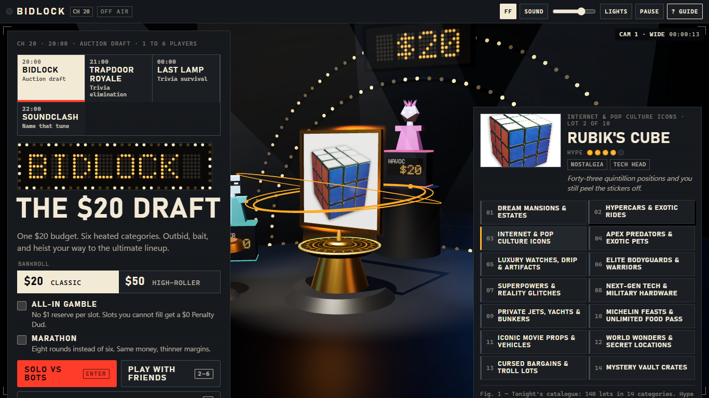 | 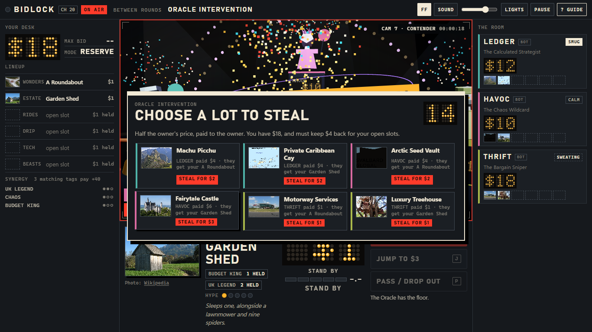 |  |

| Lobby | Six in a room | Heist |
| --- | --- | --- |
| 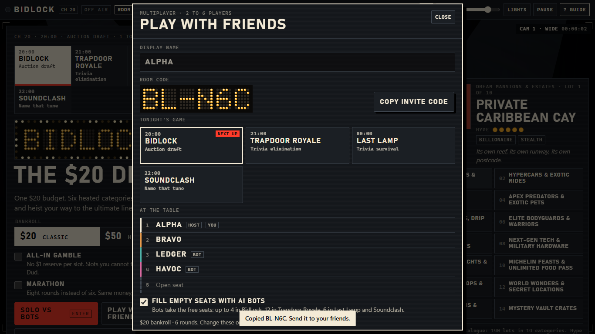 | 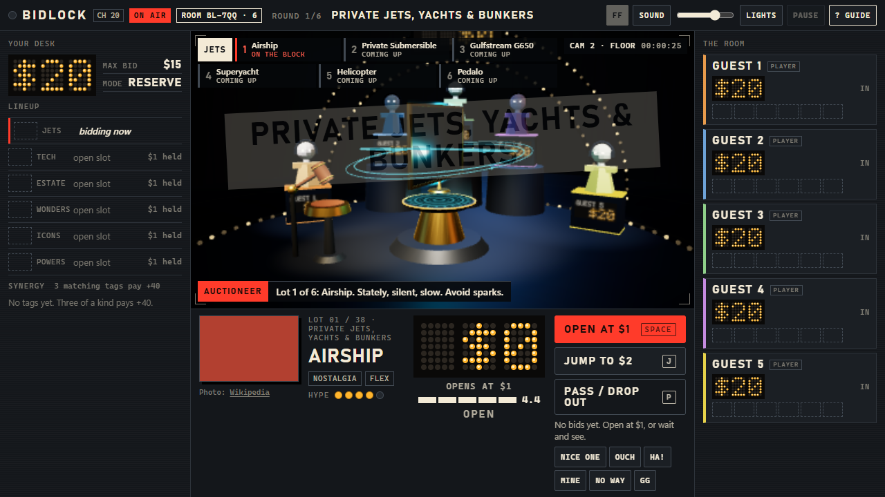 |  |

## Four shows on Channel 20

Pick a show on the title screen, or in the lobby when you host a room. After a game, the host takes the room back to the lobby, everyone can vote on what to play next, and the next game starts without anyone re-entering the code.

| Show | What it is | Players |
| --- | --- | --- |
| **BidLock** | The $20 draft auction described below | 1 to 6 people, bots fill to 4 |
| **Trapdoor Royale** | Trivia elimination on a floating arena | 1 to 6 people, bots fill to 12 |
| **Last Lamp** | Trivia survival in a lighthouse in a storm | 1 to 6 people, bots fill to 6 |
| **Soundclash** | Name that tune from a warped three-second loop, with sabotage | 1 to 6 people, bots fill to 6 |

All four share the room-code lobby and the sound engine; the three quiz games share the trivia question engine.

**Questions.** There are 310 built-in questions (`js/arcade/questionBank.js` plus the original 50), tagged easy, medium or hard, in four styles: straight questions, odd one out, which came first, and finish the saying. When the Open Trivia DB is reachable the quiz games also fetch 50 of its questions per match, across every category and difficulty, using a session token so the service does not send the same question twice. Each device remembers the last 900 questions it asked and holds them back until the rest have been used: playing offline and alternating the two games, the first repeat comes in match 22. Both games start easy and get harder as the match goes on. BidLock's Oracle draws from the 113 hardest general-knowledge questions.

### Trapdoor Royale

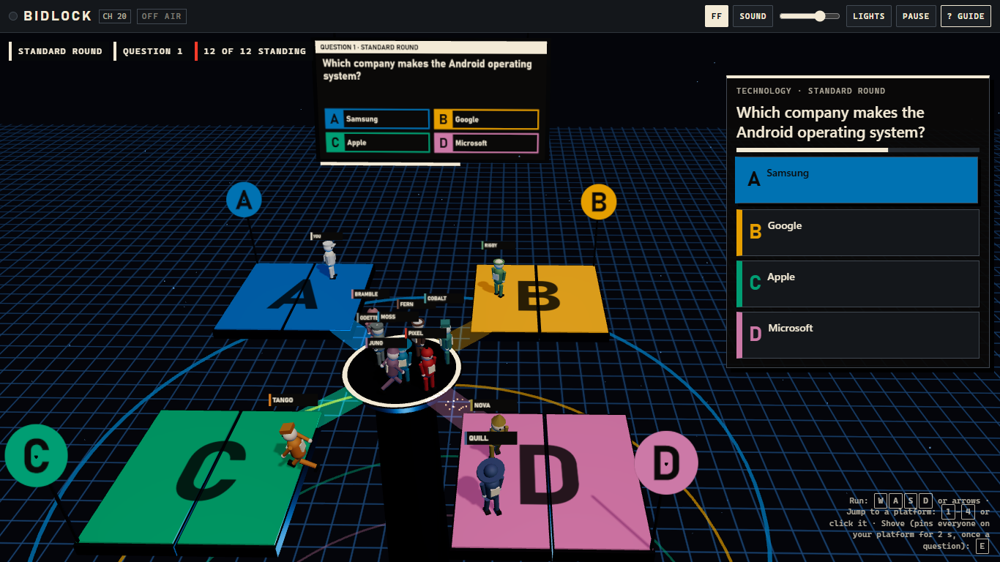

A question goes up on the board over the arena with four answers, one per coloured platform. Run to the platform you trust (WASD or the arrow keys, `1` to `4`, or click the platform or its answer). You can change your mind until the clock runs out. Once a question, `E` shoves: everyone sharing your platform is pinned there for two seconds, while you are free to leave. When time is up the bridges retract, the spotlights come on, and the three wrong platforms open like trapdoors. Anyone on them, or still dithering in the middle, falls.

- **Standard rounds** give 16 seconds. From question 4 they are **speed rounds** of 10 seconds.
- With three or fewer left it is **sudden death**: if everyone finds the right platform, the last one to arrive drops anyway.
- If nobody finds it, the floor holds and everyone goes again.
- From question 2, about every other question carries a **twist**, never the same one twice running:

  | Twist | What happens |
  | --- | --- |
  | Blackout | The answers stay dark until the last 5 seconds. |
  | Shuffle | Halfway through, every answer jumps to a different platform. |
  | Crumble | Halfway through, one wrong platform gives way early, with anyone on it, and stays closed. |
  | Reprieve | One wrong platform holds when the floor drops. Nobody knows which. |
  | Double Up | Two platforms are safe this time. |
  | Last Gasp | Half the usual time. |

  Only Blackout and Last Gasp happen in sudden death.
- The first contestant to reach the right platform earns a **safety net** (a ring at their feet), which catches them on one wrong answer. Nets do not help in sudden death.
- Once you are out you can still **call** each answer from the sidelines; right calls are counted on the results card. Solo, you can **skip to the end**, and once every person in a room is out the bots finish at four times speed.
- The last one standing rises on the central pillar as champion.

Up to twelve contestants: everyone in the room, then bots. Each bot has a knowledge level and a habit: some commit early, some follow the crowd, some change platform at the last second. The answer panel does not count heads; you read the crowd in the arena. The platforms use the Okabe-Ito colours, which stay distinct for common colour-vision differences, and always carry their letter too.

### Last Lamp

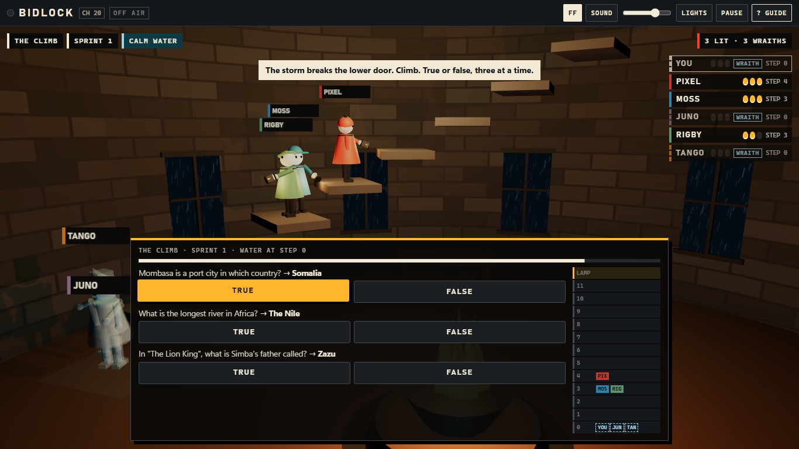

Six keepers, a storm, and three flames each, carried in a lantern. Every round everyone answers a question in secret. Keepers who answer right stay by the fire. Keepers who answer wrong drop through the hatch into **the Undertow** and play one of seven survival games; the losers each lose a flame (two flames from question 5).

| Survival game | How it works |
| --- | --- |
| **The Loose Plank** | A keeper who answered right secretly loosens one plank. Everyone below picks a plank to stand on. Whoever picked the loose one goes into the water, and a saboteur who catches someone relights one of their own flames. If nobody was caught and the saboteur was one of the crew, the saboteur goes through it. |
| **The Rising Tide** | Work the pump: five right quick sums each before the water wins. A wrong sum costs a stroke. |
| **The Lifeboat** | Share or shove, chosen in secret. If everyone shares, everyone is safe. If anyone shoves, the shovers stay dry and everyone who shared goes over. If everyone shoves, everyone goes over. |
| **The Tally** | A number question ("How tall is Kilimanjaro?") with four guesses, none exactly right. Whoever picked the guess furthest from the truth loses. If everyone agrees, they are safe only if they agreed on the closest guess. |
| **The Bell Buoy** | The buoy flashes a pattern of four to seven signals, one at a time. Signal it back in order; one wrong signal and you are under. The pattern gets longer later in the match. |
| **The Manifest** | Three quick easy questions; get two right to climb out. |
| **The Storm Capstan** | Six sockets, one holds the lightning. On your turn, pull the next socket, or spin the wheel for a fresh one-in-six and pull twice. The panel shows the odds: spinning only pays once the next socket is worse than about one in three. |

From question 2, about every other question brings **weather** that changes one rule for that question:

| Weather | What happens |
| --- | --- |
| Calm Water | Answer right and a lost flame is relit. |
| Lightning | The slowest right answer goes down the hatch too. |
| Fog | The answers only show after six seconds. |
| Undertow | A lost survival game costs two flames. |
| Beacon | Right answers are worth a step of head start on the climb. |

A keeper with no flames becomes a **wraith**: see-through and still answering. Every two right answers is a step of head start on the stairs, up to three. The lamp can never go fully dark: if a game would snuff out the last keepers, they hold on with one flame.

When two keepers or fewer are left, or after seven questions, the storm breaks the lower door and it ends on **the climb**. Each sprint shows three statements, getting harder as you climb ("Who wrote Things Fall Apart? → Wole Soyinka"); mark each true or false, and every right mark is a step up. Keepers start a step higher for every spare flame. Wraiths drift up two extra steps a sprint, and a wraith that reaches a keeper's step takes their lantern: the keeper becomes the wraith and slips back two steps. The water rises a step each sprint (two from the third), and a keeper it reaches is snuffed. The first keeper into the lamp room, step 12, lights the lamp and wins. In simulations about one match in seven is won by someone who had already become a wraith.

### Soundclash: the 3-second sample arena

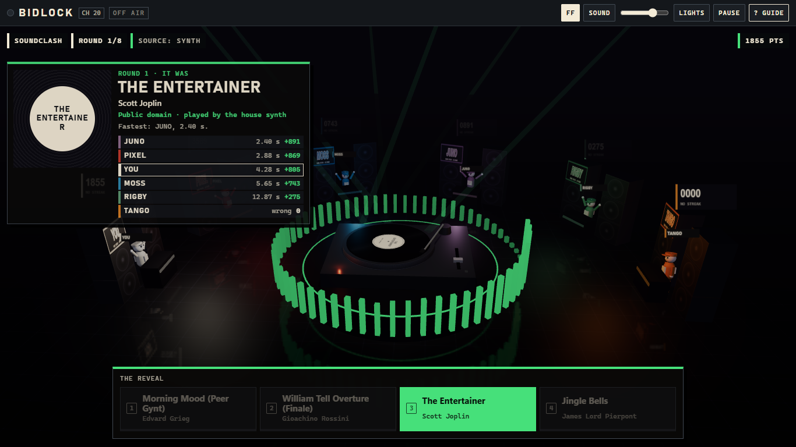

| A rival's dubplate lands | The shockwave | The podium |
| --- | --- | --- |
| 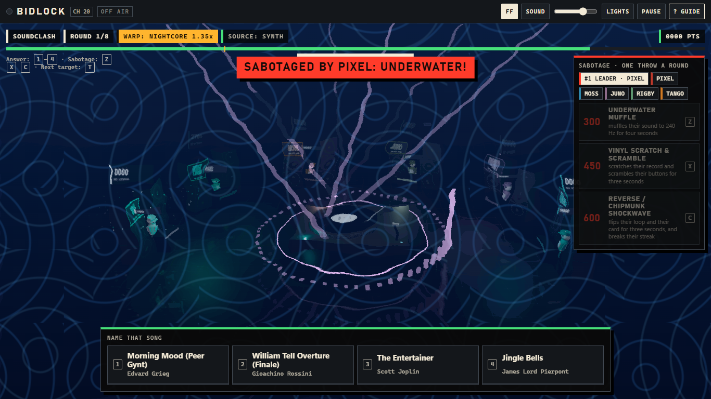 | 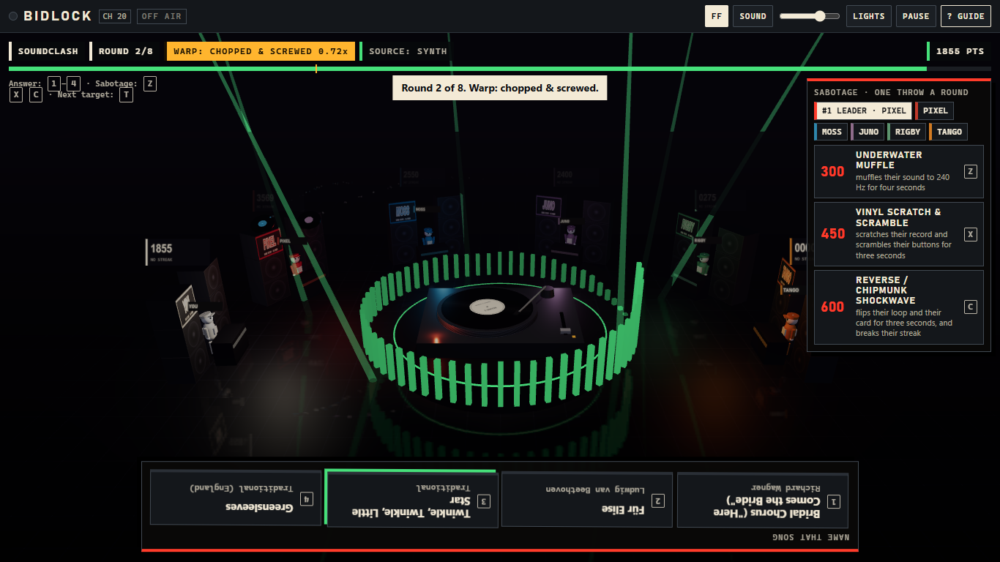 | 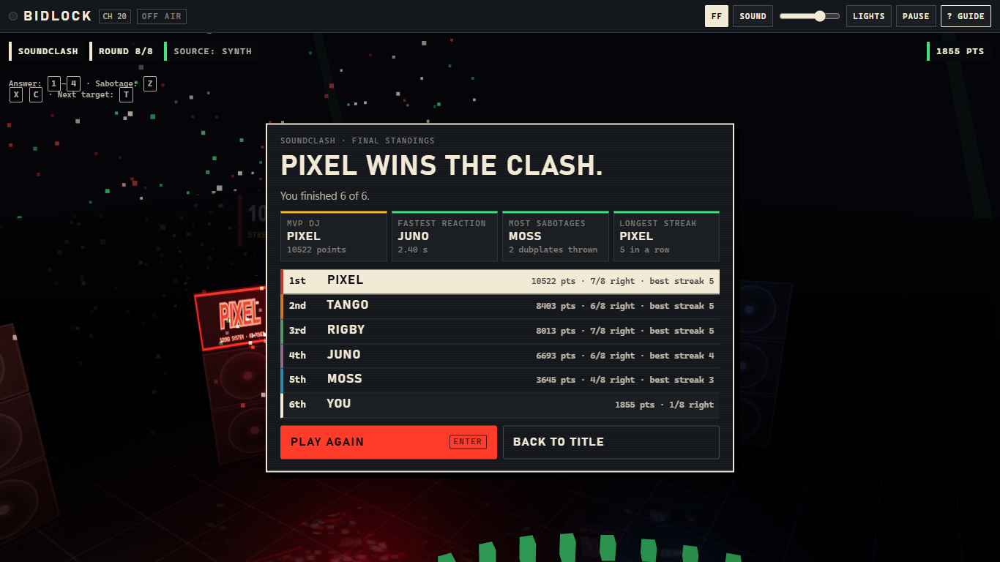 |

A sound clash is a battle between sound systems, a tradition that started in Jamaica in the 1950s. Here every player is a "sound" with their own speaker stack. Each of eight rounds loops a three-second hook from a real song, warped, and offers four titles from the same crate of music:

| Warp | What you hear |
| --- | --- |
| Nightcore | 1.35x, speed and pitch up |
| Chopped & screwed | 0.72x, slowed and pitched down |
| Underwater sub | a 320 Hz low-pass with heavy resonance |
| Reverse spin | the three seconds played backwards |
| Clean cut | the last round, the "dubplate special": unwarped, double points, and a wrong answer costs 250 |

Name it with a click or 1 to 4. A right answer is worth 1,000 points at the drop, falling to 500 by eleven seconds. Then the warp lifts for five seconds of overtime, worth 350 falling to 150. You can change your answer until the clock runs out; your time is when you last picked. Right answers in a row multiply: ×1.2, ×1.5, then ×2.

Points are also ammunition. Once a round you can throw a dubplate at a rival, or at whoever leads:

| Sabotage | Cost | What it does |
| --- | --- | --- |
| Underwater muffle | 300 | Clamps their audio to 240 Hz for four seconds and ripples their screen blue |
| Vinyl scratch & scramble | 450 | A scratch and a pitch drop in their ears, and their answer buttons (and keys) shuffle for three seconds |
| Reverse / chipmunk shockwave | 600 | Their loop flips to reverse or 1.5x chipmunk, their answer card turns upside down, and their streak is broken |

The house sounds answer faster for popular songs and worse under heavy warps. Occasionally one throws a dubplate at a person in the lead. In simulations against five bots, a player who knows 50% of songs wins about 23% of matches and one who knows 90% wins about 77%. Thrown at a leader on a streak, a sabotage is worth its price; thrown every round, it costs you the match.

**Crates and difficulty.** Pick the music on the title screen, or as host in the lobby: Global Pop & Chart Toppers; Hip-Hop, Rap & Trap; UK Grime, Drill & Afrobeats; 2000s & 2010s Throwback Anthems; Rock, Indie & Alt Classics; Anime Openings & Endings; or the All-Genre Shuffle.

- **The artist crates.** Every artist a crate searches has a curated list of their famous songs (`js/games/sampleArena/hits.js`, checked against what the iTunes Search API actually returns). **Easy** asks only about those hits, uses only the gentle warps (nightcore, chopped and screwed) and puts every wrong answer by a different artist; **Normal** asks about the hits with every warp; **Hard** asks about everything else they have released. A match makes three to four searches and draws the wrong answers from them.
- **Anime Openings & Endings.** Not artists but 59 named songs (`js/games/sampleArena/animeSongs.js`): openings, endings and film songs people know and love, from Gurenge and unravel to A Cruel Angel's Thesis, Blue Bird and Idol, each shown with its anime in brackets: "Gurenge (Demon Slayer)". Every song was checked on the store, by its artist, in its original version. A match searches for eleven of them (eight and three spares); the songs found are remembered on the device for a fortnight, so a run of matches stays under Apple's limit of about 20 searches a minute. The wrong answers come from the catalogue: on **Easy** from other anime by other artists, on **Hard** from the same anime where it can (three other Attack on Titan openings).

Store listings drift, so `node tools/check-songs.mjs` re-checks the anime catalogue and every artist's hit list against the live store and prints what to fix (about eight minutes, paced for Apple's limit).

Every match uses the free [iTunes Search API](https://performance-partners.apple.com/search-api) (no key), keeps songs with a 30-second preview, and drops covers, karaoke, remixes, instrumentals and live takes.

**Audio that never goes silent.** `sampleAudioFX.js` has three tiers:

1. **Web Audio buffer.** The preview is fetched and decoded, and the three-second window becomes a loop with a 20 ms equal-power crossfade baked into the seam, so it never clicks. It runs through `BiquadFilter → WaveShaper → Analyser (fftSize 128, 64 bins)`. This tier gives true reverse, pitch warps, filters and a live spectrum.
2. **HTML5 audio.** If the preview cannot be fetched (CORS, a flaky network), the same URL streams through an `<audio>` element, with `playbackRate` and `preservesPitch = false` for the warps. Reverse becomes a slowed "radio" take, filters become a muffled level plus synthesised noise, and the spectrum ring follows a beat-synced envelope.
3. **Offline synth.** With no iTunes at all, the match uses 24 public-domain tunes (Beethoven, Grieg, Joplin, Rossini, folk songs) rendered by a small chiptune band into a buffer. They then go through tier 1's whole graph.

The source chip on screen says which tier is playing. The previews are Apple's, provided to promote the store: the reveal shows the album artwork and links each song to Apple Music, and the screen credits the previews to iTunes.

**Design: "the clash."** The club is built from the sound-system tradition and the DJ's own equipment:

| Reference | Became |
| --- | --- |
| Jamaican sound clashes, from Tom the Great Sebastian vs Count Nick in 1952 | The format: every player is a "sound"; a reveal is a judgement by the crowd (cheer or groan) |
| Dubplates, the one-off acetates cut for a sound and used as weapons in a clash | Sabotage: a dubplate in your colour arcs across the room and hits a rival's stack; the clean last round is the "dubplate special" |
| Speaker stacks with hand-painted names, as at Notting Hill Carnival | Each player's booth: two columns of cabinets with the sound's name painted on the top box |
| The "pull up" airhorn, when the crowd demands a rewind | Three right in a row sounds the horn: "PULL UP!" |
| The Technics SL-1200: strobe dots on the platter edge, the pitch fader, the strobe lamp | The centre turntable. The dots stand still at true speed and creep when the warp changes the pitch, the fader rides up or down with the warp, and the platter runs backwards in reverse |
| Club laser rigs and graphic-equaliser bars | 64 spectrum pillars around the riser, fed by the analyser, and lasers that fire on the bass |

Colour has one job each: green is the music (spectrum, lasers, the clock), amber is the warp, red is a hit, and every sound keeps its own colour.

Sources:
- [Sound clash](https://en.wikipedia.org/wiki/Sound_clash) and [Dubplate](https://en.wikipedia.org/wiki/Dubplate), Wikipedia; [A history of soundclash](https://daily.redbullmusicacademy.com/2016/10/a-history-of-soundclash), Red Bull Music Academy Daily
- [Channel One sound system, Notting Hill Carnival](https://www.londonmuseum.org.uk/collections/v/object-1007399/channel-one-sound-system-notting-hill-carnival/), London Museum
- [Technics SL-1200](https://en.wikipedia.org/wiki/Technics_SL-1200), Wikipedia; [Features of the SL-1200](https://www.technics.com/global/sl1200/features/), Technics
- [AudioBufferSourceNode](https://developer.mozilla.org/en-US/docs/Web/API/AudioBufferSourceNode), MDN
- [iTunes Search API](https://developer.apple.com/library/archive/documentation/AudioVideo/Conceptual/iTuneSearchAPI/index.html), Apple

### How the quiz games fit in

Each arcade game is a pure rules engine (`royaleEngine.js`, `lampEngine.js` with `undertowMinigames.js`, `sampleArenaEngine.js`) plus a Three.js scene and a screen. They follow the same pattern as BidLock's auction engine: deterministic for a seed, with `serialize()` and `hydrate()` so a guest's browser mirrors the host's match. On the wire they use one envelope each way: the host sends `G` (an event and a snapshot) and `GT` (clock ticks); players send `GI` (an input). Nothing secret leaves the host before it is revealed: not the right answer, not anyone's secret answer, not the loosened plank, not who chose to shove, not which statements are true. In Soundclash the right title and everyone's picks stay on the host until the reveal; guests do get each round's preview URL, because their own speakers have to play it.

In Trapdoor Royale the shared state is which platform each contestant has chosen, not where their feet are. Each browser runs the avatars to their platforms itself, so twelve contestants stay in step without streaming positions.

## Play

```bash
node tools/serve.mjs
```

Then open `http://localhost:5173`. Any static file server works (`python -m http.server`, VS Code Live Server). Opening `index.html` straight from disk does not, because browsers block ES modules on `file://`.

## Rules

**Setup.** Two to six contenders, each with $20 (or $50 in High-Roller mode). A match drafts six of the thirteen lot categories, picked at random, or eight in Marathon mode. No lot appears twice in a match.

**A round.** Each round sells one lot per contender from one category, and every contender must end the round with exactly one. The weakest lot always comes last, so a round is musical chairs: whoever never commits is left with the booby prize for $1.

**Bidding.** Lots open at $1. You can bid one dollar more, power-jump two, or drop out of the lot for good. Every bid resets the shot clock to 5.0 seconds: going once at 3, going twice at 2, last call at 1, then the hammer.

**Budget lockout.** Your max bid is your cash minus $1 for every other slot you still have to fill, so you can never lock yourself out of a round. Tick **All-In Gamble** to play without that reserve; any slot you cannot fill gets a $0 Penalty Dud.

**Mystery crates.** Two sealed crates are dropped between rounds. You see a crate and one clue. When the winner's crate bursts open, the photograph of what was inside appears. Crates sit outside the round slots and add to your total.

**The Oracle.** After any round from the second onward (but not the last), there is a 45% chance of an Oracle intervention, at most twice a match. One contender is picked at random from those who still have a slot to fill and can afford at least one rival's lot at half price.

1. They get one hard general-knowledge question and 20 seconds. Everyone watches. Wrong or out of time, and the chance is gone.
2. Right, and they choose any rival's lot to take for half what that rival paid (rounded down, at least $1). The rival gets that half back, and is left holding the thief's lot from the same category.
3. Before the lot moves, they have 10 seconds to choose: **lock in the half-price steal**, or **double or nothing**. Double or nothing is a second hard question. Right, and the lot is free. Wrong, and the whole steal is forfeited.

**Vault.** After the last lot you have ten seconds to pay $2 to lock a lot. Locked lots cannot be stolen.

**Heist.** Then ten seconds in which each contender may make one steal from any unlocked lineup. It costs what the owner paid plus $1, and it is a forced swap.

**Verdict.** The sealed value of every lot (1 to 100) is revealed round by round. Three lots sharing a synergy tag pay +40; five pay +80. Highest total wins. Leftover cash only breaks ties.

### What you can and cannot see

| Public | Sealed until the verdict |
| --- | --- |
| Lot photograph, name, tags, hype (1 to 5 lamps) | True value and tier |
| The lots of the round, in order | What is in a crate |
| Everyone's cash and lineup | The answer to an Oracle question |

Hype is the room's opinion and is sometimes wrong. In the Cursed Bargains round it is wrong on purpose.

### The catalogue

140 lots in 14 categories, 10 each: Dream Mansions & Estates · Hypercars & Exotic Rides · Internet & Pop Culture Icons · Apex Predators & Exotic Pets · Luxury Watches, Drip & Artifacts · Elite Bodyguards & Warriors · Superpowers & Reality Glitches · Next-Gen Tech & Military Hardware · Private Jets, Yachts & Bunkers · Michelin Feasts & Unlimited Food Pass · Iconic Movie Props & Vehicles · World Wonders & Secret Locations · Cursed Bargains & Troll Lots · Mystery Vault Crates.

### The house rivals

| Rival | Style | Tell |
| --- | --- | --- |
| **LEDGER**, the Calculated Strategist | Works out a dollar limit from value per point and never goes past it | Bids late; snipes headline lots with 0.6 s on the clock |
| **HAVOC**, the Chaos Wildcard | Plays All-In with a noisy read on value | Power-jumps crates and junk to bait people, then drops out |
| **THRIFT**, the Bargain Sniper | Hoards through the first half, then outspends a broke room | Rarely goes above $2 early |

Each has a reaction delay of 350 to 1400 ms, four moods that change their timing and lines, and its own vault, heist and Oracle behaviour. They do not know the trivia answers: each has a chance of being right.

## Playing with friends

1. On the title screen choose **Play with friends**, enter a display name, and **Create lobby**. You get a code like `BL-7K9`.
2. Send the code to your friends. They choose **Play with friends**, enter a name and the code, and **Join room**. A link ending `?room=BL-7K9` opens the lobby with the code filled in.
3. The host picks the bankroll and mode on the title screen, decides whether bots fill the empty seats (up to four at the table), and presses **Start match**.
4. After the verdict the host can **Play again** or go **Back to lobby**. The room and its code stay open, so nobody re-enters anything.

Two to six people can play. There is no pausing or fast-forward in a room, and the vault and heist end early once everyone has pressed Done. If a guest leaves, their seat stays in the match and stops acting. If the host leaves, the room closes.

### How it works

The host's browser runs the only real game engine. Every other player reaches it in one of two ways:

- **Through the BidLock room server** (`server/`, described below): every player keeps a WebSocket to the room, and the server only passes messages between the host and the players. A WebSocket is an ordinary HTTPS connection, so this works on any network that can open a web page, including school Wi-Fi that keeps devices apart, strict mobile networks, and browsers that block WebRTC.
- **Directly over WebRTC**, using [PeerJS](https://peerjs.com/) and its free public signalling server, when the room server is not set up or cannot be reached. The host opens every room on both, so a guest whose network blocks the room server can still come in directly.

Guests send small inputs; the host checks each one against the rules and broadcasts every engine event with a snapshot of the match. A guest's browser rebuilds a read-only mirror of the engine from each snapshot, so the same HUD, stage and sound code runs for everyone.

| Host to everyone | Player to host |
| --- | --- |
| `NEW_LOT`, `BID_PLACED`, `TIMER_TICK`, `LOT_SOLD`, `TRIVIA_STEAL_TRIGGERED`, `HEIST_ACTION`, `FINAL_RESULTS`, `EVENT`, `LOBBY`, `START` | `PLACE_BID`, `PASS`, `SUBMIT_TRIVIA_ANSWER`, `STEAL_TARGET`, `DOUBLE_OR_NOTHING_CHOICE`, `VAULT_LOCK`, `DONE`, `EMOTE` |

A player's seat is taken from their connection, never from the message, and the answer to an Oracle question is not sent to the room until it has been given.

**Riding out drops.** Through the room server, a dropped connection reconnects by itself and carries on. The room keeps a host's place for five minutes and a player's for one, and holds what was sent to them meanwhile. Both ends count the messages they receive, so on reconnecting each side resends what the other missed: even a connection that died without anyone noticing (a phone changing networks) loses nothing. While the host is away, guests see HOST AWAY on their room chip, and a friend who joins with the code waits at the door for up to three minutes ("you will be let in as soon as they are back") instead of timing out. That covers the most common failure in a party: a host on a phone who switches to a messaging app to send the code.

**Joining over PeerJS is patient.** A guest retries for about 50 seconds before giving up, and the lobby says what is happening ("Still connecting… try 2 of 4"). This covers the most common failure: a host on a phone who switches to a messaging app to send the code. That pauses the page and takes the room off the signalling server, so friends joining at that moment cannot get in. The host reconnects as soon as they come back, and the waiting guests get in then. The host's lobby says so: send the code, then come back.

**Smoothing the link for guests.** Everything a guest sees has crossed the network, so the room measures each player's delay and makes up for it:

- The host pings every player every two seconds. The lobby shows each guest's round trip (green under 120 ms, amber under 250, red above), and a guest's room chip shows their own and turns amber on a slow link.
- Clocks are corrected, not copied. Every tick from the host is one network delay old when it lands, so a guest subtracts that delay and eases small differences in, instead of jumping. In tests with 150 ms each way, a guest's clock stayed within a few hundredths of a second of the host's.
- The delay used for corrections is the quickest of the last six pings, not the average. A busy page only ever adds delay to a ping, so the quickest is the truest measure of the link (as NTP does).
- Inputs are timed when they were sent. In the quiz games a guest's answer or move is back-dated by their measured delay (at most 0.3 s), so a guest on a slow line is not marked slower than they were. In BidLock the hammer waits for the slowest guest's delay before it falls, so a bid made in time on a guest's screen still counts.
- Snapshots travel as changes. After the first full snapshot, an event carries only the parts of the match that changed, with a full one every 25 events. A BidLock match sends each guest about 570 KB instead of 4 MB, 86% less, which matters most on a phone's upload when it hosts.

To try a slow link without one, add `?net=local&lag=150` to two tabs: every message is held back 150 ms each way.

**Check my connection.** The lobby has a button that checks, in plain words, everything a room needs. First, whether the BidLock room server answers: if it does, rooms work from that device and the check says so. Otherwise it checks the direct route: whether PeerJS's server answers, whether this browser allows WebRTC, whether the network lets the connection helper (STUN) through, and whether a relay is available. It ends with what to do. It also runs by itself when a join fails, and writes one line to the browser console (starting `[BidLock rooms]`) that sums it up for whoever is helping. Two common causes it catches:

- **Brave, uBlock Origin or a VPN restricting WebRTC.** Brave's "WebRTC IP handling policy" set to "Disable non-proxied UDP", which uBlock Origin's "Prevent WebRTC from leaking local IP addresses" turns on, stops direct connections entirely. The room server gets round it; without the room server, the fix is to set the policy back to Default or untick that option.
- **School or office Wi-Fi that keeps devices apart.** Everyone can be on the same Wi-Fi while one device still cannot reach the host directly. The room server gets round it too.

**TURN, if direct connections ever need one.** The room server makes a TURN relay unnecessary, but the hooks remain for the direct route. Browsers connect directly with STUN servers (Google's and Cloudflare's) to find each other; a player behind a strict NAT cannot, and would need a TURN relay. PeerJS used to bundle free TURN servers, but those hostnames no longer exist. To add one, sign up for a TURN provider with a free tier and either paste the servers it gives you into `TURN_SERVERS` in `js/net/iceServers.js` (ExpressTURN's free plan, 1 TB a month, gives one fixed username and password), or put its credentials URL in `TURN_CREDENTIALS_URL` (Metered's free plan, 20 GB a month, gives an API key and a URL that returns the servers). This is a static site, so those credentials are public: use the provider's restricted, low-quota ones. For a quick test without editing code, set `localStorage['bidlock.turn']` to the same list as JSON. When a direct connection fails, the joining player is told it is their network, not the code.

The public PeerJS signalling server is a shared free service and is occasionally busy. If the host's tab is in the background during a match, the match keeps running, but browsers slow background timers, so the host should keep the tab in front.

### The room server

| Check my connection, on a browser that blocks WebRTC | A guest while the host's connection is down |
| --- | --- |
| 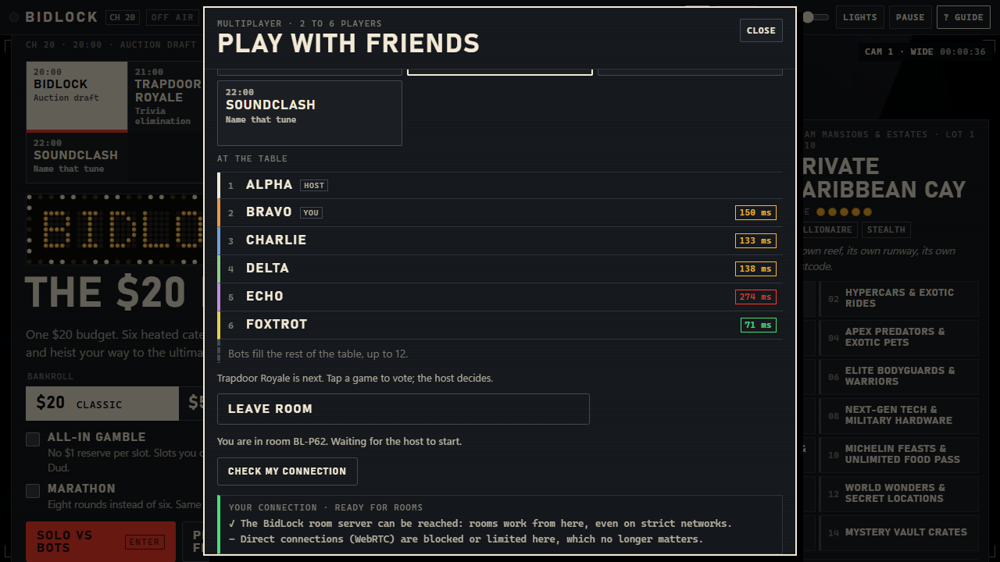 | 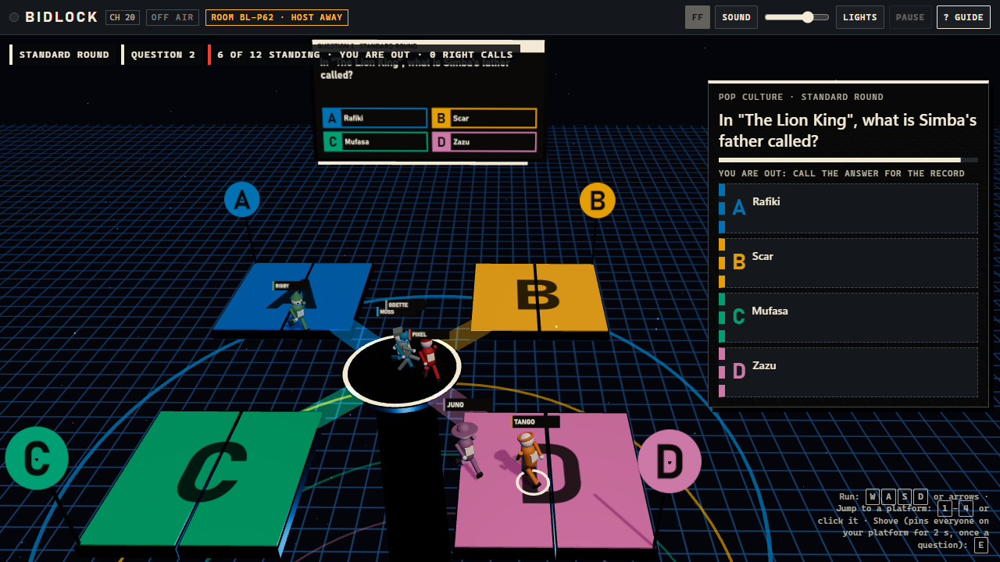 |

`server/` is a [Cloudflare Worker](https://developers.cloudflare.com/workers/) with one [Durable Object](https://developers.cloudflare.com/durable-objects/) per room code: a small, single-threaded object that every player in that room connects to. It decides nothing about the game. It passes the host's messages to the players and the players' messages to the host (one copy of a broadcast goes up, and the server hands out the rest), keeps places for people who drop out, and holds and resends what they missed. Only BidLock's own pages may open rooms (the live site, and localhost for development), players' messages are size- and rate-limited, and a room ends when its host leaves or does not come back.

It runs on Cloudflare's free Workers plan, which includes 100,000 Durable Object requests and 13,000 GB-seconds a day; incoming WebSocket messages count 20 to a request and outgoing ones are free ([pricing](https://developers.cloudflare.com/durable-objects/platform/pricing/)). An hour of a six-player room uses roughly 2,000 requests and 450 GB-seconds, so the free plan covers about 25 to 30 hours of rooms a day. If a day's allowance runs out, new rooms cannot reach the server until midnight UTC and fall back to direct connections by themselves.

**Setting it up** (once, about five minutes):

1. Make a free Cloudflare account at https://dash.cloudflare.com/sign-up, and open **Workers & Pages** once so the account gets its `workers.dev` subdomain.
2. In this folder, sign in to Cloudflare from the command line (it opens the browser to approve):

   ```bash
   npx wrangler login
   ```

3. Deploy the room server:

   ```bash
   npm run rooms:deploy
   ```

   It prints the address, like `https://bidlock-rooms.<your-subdomain>.workers.dev`.
4. Put that address in `ROOM_SERVER` in `js/net/roomServer.js` and push to `main`. To try it first without editing anything, add `?rooms=<that address>` to the page's URL.

If the site moves to another address, add it to `ALLOWED_ORIGINS` in `server/wrangler.jsonc` and deploy again. To run the room server on your own machine, `npm run rooms:dev` starts it on port 8787; open the game with `?rooms=ws://127.0.0.1:8787`.

## Controls

| Key | Action |
| --- | --- |
| `Space` or `B` | Bid one dollar more |
| `J` | Power jump: two dollars more |
| `P` | Pass and drop out of this lot |
| `1` to `4` | Answer the Oracle's question |
| `Enter` | Go live, skip an intro (solo), finish the vault or heist |
| `F` | Fast-forward lots you are not bidding on (solo) |
| `M` | Mute |
| `Esc` | Pause (solo) |
| `?` | Open the run sheet (guide, keys, glossary) |
| `←` `→` | Step through the guide |

Everything also works by mouse or touch.

## Photographs

Each lot names a Wikipedia article (`wikiQuery` in `js/data/categories.js`), and the game shows that article's lead image.

- At match start, `js/utils/mediaLoader.js` looks up every lot of the match in **one** request to the MediaWiki Action API (`action=query&prop=pageimages`, up to 40 titles per call). The brief suggested one REST summary call per lot; in testing that was rate-limited (HTTP 429) after about a hundred calls, so the summary endpoint is kept only as the fallback if the batch call fails.
- Images load with `crossOrigin = 'anonymous'` into a Three.js `TextureLoader` for the pedestal frame and into ordinary `` elements for the lot card, lineups, boards and verdict.
- Every lot has an illustrated card, drawn on a canvas, from the first moment. A photograph replaces it when it arrives. Offline, blocked, or no free image: the card stays, so nothing is ever blank.
- `node tools/check-media.mjs` checks that all 140 articles have a usable photograph.

The photographs are not part of this repository. They are loaded at run time from Wikimedia Commons under their own free licences; the "Photo: Wikipedia" link on each lot leads to the article, where the author and licence are listed. The screenshots above include some of them.

Four lots from the original wish list have no freely licensed photograph on Wikipedia (the Patek Philippe Nautilus, the Batmobile Tumbler, Air Jordans and the Ecto-1), so they were swapped for an Omega Speedmaster, a submarine spy car, Air Force 1s and a Love Bug Beetle.

## Trivia

`js/engine/triviaSteal.js` asks the [Open Trivia DB](https://opentdb.com/) for 30 hard multiple-choice questions at the start of each match, decodes the HTML entities, and keeps only proper general knowledge (history, science, geography, art, books, mythology, politics; film, game and celebrity questions are dropped). If the service cannot be reached, a built-in bank of 50 questions is used.

## Architecture

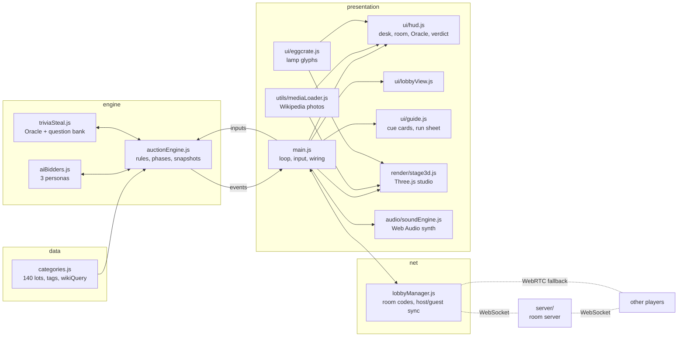

The engine is pure: no DOM, no audio, no rendering, and deterministic for a given seed. `main.js` runs it on a fixed 1/60 s timestep and turns its events into HUD updates, stage animation and sound. On a guest the same events arrive over the wire instead. That is also why the rules, the snapshots and the wire format can all be tested headless in Node.

| File | What it does |
| --- | --- |
| `index.html` | Layout, HUD regions, lobby, Oracle panel, run sheet, cue cards |
| `css/styles.css` | Design tokens, dark and light themes, layouts from 375 px up |
| `js/main.js` | Screens, the loop, input, and the solo, host and guest roles |
| `js/data/categories.js` | 14 categories x 10 lots, synergy tags, crate clues, penalty duds |
| `js/engine/auctionEngine.js` | Budget rules, shot clock, crates, vault, heist, scoring, snapshots |
| `js/engine/aiBidders.js` | LEDGER, HAVOC, THRIFT: valuation, timing, bluffing, banter |
| `js/engine/triviaSteal.js` | The Oracle state machine, Open Trivia DB loader, fallback bank |
| `js/net/lobbyManager.js` | Room codes, the transports (room server first, then PeerJS; loopback for tests), lobby, wire format |
| `js/net/relayTransport.js` | The room server connection: reconnecting, message counting and resending |
| `js/net/roomServer.js` | Where the room server is |
| `js/net/netCheck.js` | "Check my connection" |
| `server/src/index.js` | The room server: the Worker and its Durable Object |
| `js/utils/mediaLoader.js` | Wikipedia lookups, image loading, illustrated fallback cards |
| `js/render/stage3d.js` | Studio set, photo frames, gavel, podiums, particles, cameras |
| `js/audio/soundEngine.js` | Gavel, ticks, heartbeat, siren, buzzer, stings, backing track |
| `js/ui/eggcrate.js` | 5x7 lamp glyphs shared by the HUD and the 3D podium screens |
| `js/ui/hud.js` | All in-match DOM painting, chyrons, boards, scorecard text |
| `js/ui/lobbyView.js` | The lobby dialog |
| `js/ui/guide.js` | First-run guide and help drawer |
| `js/arcade/games.js` | The four shows: names, rules text, table sizes |
| `js/arcade/bots.js` | The twelve quiz-game bots and how they answer |
| `js/arcade/quizBank.js` | Questions, true-or-false trios and quick sums for the quiz games |
| `js/arcade/gameBase.js` | What the quiz games share: stepping or mirroring the engine, the room, results |
| `js/arcade/figures3d.js` | The articulated 3D contestants and keepers |
| `js/render/kit3d.js` | Shared 3D helpers and the particle pool |
| `js/games/trapdoorRoyale/` | Trapdoor Royale: rules engine, arena, screen |
| `js/games/lastLamp/` | Last Lamp: rules engine, survival games, lighthouse, screen |
| `tools/serve.mjs` | Tiny static server for local play and tests |
| `tools/check-media.mjs` | Verifies every lot's photograph |

Match phases: `CATEGORY_INTRO → LOT_INTRO → BIDDING → SOLD → (REVEAL)` for each lot, with `ORACLE` possible between rounds, then `VAULT → HEIST → VERDICT`.

## Design: "Channel 20"

The interface is a live television broadcast rather than a generic game HUD. Each reference became a specific part of the UI.

| Reference | Became |
| --- | --- |
| Eggcrate lamp displays, the bulb-matrix scoreboards of 1970s and 80s studio game shows | Every price, cash total, clock and room code, drawn lamp by lamp from a 5x7 glyph table (no font file); also the hanging price sign and podium screens in 3D |
| Character-generator lower thirds ("chyrons") | Auctioneer calls, rival banter and players' reactions slide in as tabbed lower thirds |
| Broadcast colour bars and test cards | Loading, pause, signal-lost and no-WebGL states are all a "please stand by" card |
| Camera tally lights and ON AIR lamps | The one red in the palette. It only ever means live: on air, your high bid, the button that puts you there |
| Marquee chase lights | Bulbs around the stage rim and arches, chasing faster as the hammer comes down, turning violet for the Oracle |
| Auction-house catalogue plates | Lot photographs: always in a ruled frame, always captioned with their source |
| A floor manager's cue cards | The first-run guide: ruled cards with punched holes, "CUE 3 / 12" |
| A production run sheet | The help drawer: pipeline, key map, glossary |

The guide is offered once and never forced, because Nielsen Norman Group's study of onboarding tutorials found that users who skipped them did no worse, and rated the apps easier to use.

Sources:
- [Eggcrate and other numeric displays](https://blair-neal.gitbook.io/survey-of-alternative-displays/legacy/eggcrate-and-other-numeric-displays), Survey of Alternative Displays
- [Lower third](https://en.wikipedia.org/wiki/Lower_third) and [Character generator](https://wikipedia.com/wiki/Character_generator), Wikipedia
- [Philips circle pattern](https://en.wikipedia.org/wiki/Philips_circle_pattern), Wikipedia
- [Study of mobile tutorials](https://www.nngroup.com/articles/mobile-tutorials/) and [Examples of Tutorials in Apps](https://www.nngroup.com/articles/onboarding-tutorials/), Nielsen Norman Group

Type uses system stacks only (Bahnschrift or DIN condensed for display, the system UI face for text, the system mono for labels), so no fonts are downloaded. Motion is switched off under `prefers-reduced-motion`.

## Tests

```bash
npm install
```

```bash
npm test
```

- `tests/arcade.test.mjs` runs in plain Node: 150 simulated matches of each quiz game at tables of 2 to 12, checking that exactly one champion is left, that all seven survival games, six twists and five kinds of weather turn up, that no question repeats across ten matches on one device, that the lamp never goes fully dark, that secrets stay out of snapshots, and that a guest's mirror agrees with the host.
- `tests/rooms.test.mjs` runs the room server in Cloudflare's local runtime (`wrangler dev`) and talks to it from Node: hosting and joining, messages both ways, a full room, only BidLock's pages allowed, players and hosts dropping and coming back, connections that die silently (nothing lost either way, nothing repeated), a player waiting at the door for an absent host, six whole lobbies, and the fallback to PeerJS.
- `tests/rooms.e2e.mjs` puts six real browsers in one room through the room server: one on a browser that restricts WebRTC as Brave does, one with WebRTC switched off, one on a 390 px phone. It plays Trapdoor Royale with a host whose tab is frozen, a host whose connection drops (the guests see HOST AWAY), and one whose connection dies silently, and checks that every answer still counts. It runs against a local copy of the room server; `BIDLOCK_ROOMS=wss://<address> node tests/rooms.e2e.mjs` runs the same checks against a deployed one.
- `tests/net.test.mjs` runs in plain Node: snapshot deltas that rebuild exactly (and save over half the bytes), ping measurement and its cap, the hammer's grace for a slow guest, back-dated answers, and fetched relay credentials.
- `tests/soundclash.test.mjs` runs in plain Node: the crate digger against fake iTunes answers (filtering, artwork, eight fair rounds, the offline fallback), the scoring, 200 bot matches with every invariant, sabotage rules, secrets in snapshots, the synth tunes, and the seamless loop maker.
- `tests/soundclash.e2e.mjs` drives the browser through the crate picker, all three audio tiers (a served WAV with CORS, the same file refused to `fetch`, and iTunes blocked), every sabotage, overtime, the reveal and the podium, a two-player room with a crate pick, and a 390 px phone.
- `tests/arcade.e2e.mjs` drives the browser through the channel guide, both quiz games solo, a room that votes, plays Trapdoor Royale, goes back to the lobby and plays Last Lamp, and both games on a 390 px phone.
- `tests/engine.test.mjs` runs in plain Node. It checks the database, then plays several hundred simulated matches at tables of two to six, asserting that money is accounted for, every slot is filled, no lot is owned twice and scores add up. It also covers the Oracle (half-price, free and failed steals), the question bank, and that a mirror rebuilt from snapshots agrees with the host after every event.
- `tests/e2e.mjs` drives Edge or Chrome through the title, guide, run sheet, solo bidding with photographs, the no-photograph fallback, both Oracle paths, crate, vault, heist, verdict, a two-player room from create to "back to lobby", a six-player room with a guest dropping out, a whole unattended match, and a 390 px phone. Those run offline against fixtures. Two last sections use the real network (Wikipedia photographs, and one real WebRTC room) and are reported as skipped if it is down. The run also writes the images in `screenshots/`.

The only dependencies, both for development, are `playwright-core` for the browser tests and `wrangler`, Cloudflare's tool, to run and deploy the room server.

Handy URL switches: `?seed=42` fixes the match, `?speed=4` runs the clock faster, `?auto=1` lets a simple autopilot play your seat, `?oracle=1` makes the Oracle appear whenever it can (`?oracle=0` never), `?trivia=local` uses only the built-in questions, `?media=off` uses only illustrated cards, `?net=local` shares rooms between tabs of one browser with no network, `?guide=off` hides the first-visit invitation, `?music=offline` plays Soundclash from the offline synth crate, `?lag=150` (with `?net=local`) delays every room message by 150 ms each way, `?net=relay` uses only the room server and `?net=peer` only direct connections, `?rooms=<address>` points rooms at another room server (`?rooms=off` for none).

## Deploy

The repository is the site. Nothing needs building.

**GitHub Pages**
1. Push to GitHub.
2. In the repository, open Settings → Pages.
3. Under "Build and deployment", choose "Deploy from a branch", branch `main`, folder `/ (root)`, and save.

The empty `.nojekyll` file tells Pages to serve the files as they are.

**Netlify or Vercel**: import the repository, leave the build command empty and set the publish directory to the repository root.

**The room server** is deployed separately, with `npm run rooms:deploy` (see [The room server](#the-room-server)). Deploying the site does not touch it, and it only needs deploying again when `server/` changes.

## Notes

- **What is fetched from the network:** the room server (only in a room), Three.js and (only when you open the lobby) PeerJS from a CDN, lot photographs from Wikipedia, trivia questions from the Open Trivia DB, and Soundclash's songs, previews and artwork from Apple's iTunes Search API. All three have built-in fallbacks. Without Three.js the feed shows a NO SIGNAL card and the auction still plays from the desk.
- **Slow graphics.** If frames run slow the stage lowers its resolution and turns shadows off by itself.
- **Sound starts on your first click or key press**, because browsers do not allow audio before that.

## Credits

The format is inspired by YouTube draft-auction videos in which a group builds lineups on a $20 budget. BidLock is an original game: the rivals, rules, sound and code are its own, and it is not affiliated with or endorsed by any creator, channel or brand whose products appear as lots. Lot photographs are by Wikimedia Commons contributors. Trivia questions are from the Open Trivia DB (CC BY-SA 4.0) when it is reachable. Soundclash's song previews and artwork are provided by Apple through the iTunes Search API and link back to Apple Music; the offline tunes are public-domain compositions, arranged for the house synth.
